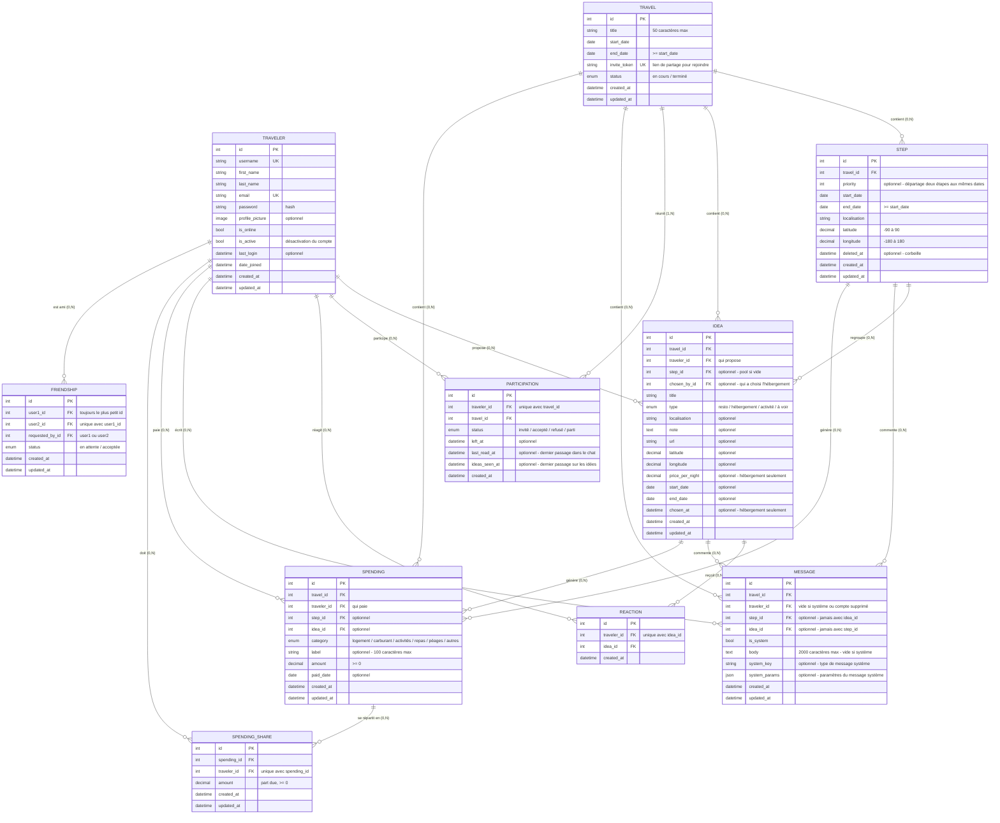

# Modèle de données

**Aligné sur le code (`srcs/backend/*/models.py`) au 11/11/2026.** Les noms de champs sont ceux des modèles Django.

## Principes produit

- **Planifier, pas naviguer.** Sur la route, c'est Google Maps. L'app rassemble les idées et définit le trajet ensemble. L'ordre des étapes découle de leurs dates, fixées par l'utilisateur, pas optimisé.
- **L'étape est le trajet, l'idée est ce qu'on y fait.** L'étape dessine la ligne sur la carte. L'idée est une proposition rattachée à une étape ou au voyage : où dormir, manger, quoi voir.
- **Le ❤️ est un signal, pas une décision.** On en met sur autant d'idées qu'on veut, il ne déclenche rien. Choisir un hébergement est une action explicite.

## Schéma

## Notation

- `PK` clé primaire, `FK` clé étrangère, `UK` valeur unique
- `||--o{` : un vers plusieurs — la cardinalité est aussi écrite en clair sur chaque relation
- Toutes les tables ont un `id` auto. Les tables de liaison (`Reaction`, `Participation`, `Friendship`, `SpendingShare`) imposent l'unicité du couple par une `UniqueConstraint`, pas par une clé primaire composée.
- `created_at` / `updated_at` viennent de `common.models.TimeStampedModel` (`auto_now_add` / `auto_now`). `Reaction` et `Participation` n'ont pas d'`updated_at` : un ❤️ ne se modifie pas, et `left_at` porte déjà le changement d'état d'une participation.
- Les énumérations sont des `TextChoices` Django stockées sur un caractère (ex. `Travel.status` : `c` / `f`).
- `Idea`, `Message`, `Spending` et `SpendingShare` héritent aussi de `ValidatedModel` : `full_clean()` est appelé à chaque `save()`, donc les règles de `clean()` décrites plus bas s'appliquent partout, pas seulement via l'API.

## Détails des tables

- **Traveler** : un compte, basé sur `AbstractUser` de Django (d'où `username`, `password`, `is_active`, `is_staff`, `last_login`…). `email` est unique. `profile_picture` est un fichier uploadé dans `profile_pictures/`. `is_online` sert au statut en ligne des amis. Désactivable (`is_active`) plutôt que supprimé.
- **Travel** : un voyage, avec ses dates de début et de fin (`end_date >= start_date`, contrainte en base ; l'API est plus stricte et exige `end_date > start_date` : un voyage dure au moins une nuit, code `end_not_after_start`). `invite_token` est généré à la création et permet à quiconque le possède de rejoindre. Aucun propriétaire : tous les participants ont les mêmes droits. Le créateur reçoit une participation acceptée.
- **Participation** : qui participe à quel voyage et où en est son invitation. Une personne partie garde sa ligne (`status` parti + `left_at`), pour que les soldes restent justes. `last_read_at` et `ideas_seen_at` retiennent le dernier passage dans le chat et sur la page des idées : les non-lus sont ce que les autres ont créé après, aucun compteur n'est stocké. Accepter une invitation remplit ces deux dates, pour que l'historique ne s'affiche pas comme nouveau.
- **Step** : un arrêt du trajet, défini par `start_date` / `end_date`. Le nombre de nuits n'est pas stocké : l'API le calcule (`end_date − start_date`, 0 pour une halte). Contrairement au voyage, l'API accepte `end_date = start_date` pour une étape (halte sans nuit). Deux étapes vivantes d'un même voyage ne peuvent pas se chevaucher (une étape peut commencer le jour où la précédente finit). `priority` sert seulement à ordonner deux étapes aux mêmes dates, et est unique par voyage + dates parmi les étapes vivantes. Les étapes sont triées par `start_date`, `end_date`, `priority`, `created_at`. `latitude` / `longitude` sont obligatoires.
- **Idea** : une proposition faite pour un voyage. Rattachée à une étape, ou libre dans le pool (étape vide ou à la corbeille). Son statut n'est **pas stocké**, il se déduit (voir plus bas). Règles vérifiées par `clean()` :
  - l'étape doit appartenir au même voyage ;
  - `start_date` et `end_date` sont remplies ensemble ou pas du tout, et restent dans les dates de l'étape ;
  - un hébergement a toujours des dates, au moins une nuit, et s'il est dans le pool ses dates restent dans celles du voyage ;
  - une autre idée placée sur une étape a des dates, sur un seul jour ; dans le pool elle n'en a pas ;
  - `price_per_night` est réservé aux hébergements ;
  - seul un hébergement placé sur une étape peut être choisi (`chosen_at`), et deux hébergements choisis d'une même étape ne peuvent pas se chevaucher.
- **Reaction** : un ❤️ d'une personne sur une idée, un seul par personne et par idée. Purement indicatif.
- **Friendship** : un lien d'amitié entre deux comptes, indépendant des voyages. `user1 < user2` et `requested_by` {user1, user2} sont des contraintes en base. Un refus ou un retrait supprime la ligne.
- **Message** : un message du chat, rattachable au voyage, à une étape ou à une idée (pas les deux, contrainte en base). L'auteur doit être un participant (accepté ou parti) à la création. Un message système (`is_system`) n'a pas d'auteur, pas de `body` mais un `system_key` (ex. `participant_joined`, `participant_left`) et des `system_params` : le texte est construit par le front.
- **Spending** : une dépense, rattachable au voyage seul (carburant), à une étape (péage) ou à une idée (le resto qu'on a fait). Étape et idée doivent appartenir au même voyage, et si l'idée est sur une étape, l'étape de la dépense doit être la même. `amount` est `>= 0` en base, mais l'API exige au moins `0.01` (pas de dépense à 0). `category` sert aux regroupements de l'écran budget, `label` précise de quoi il s'agit. Le payeur doit être un participant du voyage (statut accepté ou parti).
- **SpendingShare** : la part d'une dépense due par un voyageur. Un voyageur a au plus une part par dépense, et doit lui aussi être un participant accepté ou parti. Les parts sont figées à la création : quelqu'un qui quitte le voyage reste redevable des dépenses faites avant son départ. Sans parts fournies, la dépense est partagée à parts égales entre les participants acceptés. La somme des parts doit égaler `Spending.amount`, vérifiée par `spending/services.py` (plusieurs lignes, donc pas dans `clean()`).

## Statut d'une idée (calculé)

`Idea.status` est une propriété, pas une colonne :

- **proposée** (`s`) : dans le pool (pas d'étape, ou étape à la corbeille) ;
- **choisie** (`c`) : hébergement placé sur une étape avec `chosen_at` rempli ;
- **placée** (`p`) : sinon, idée rattachée à une étape vivante.

Choisir un hébergement passe par `POST /travels/<id>/ideas/<id>/choice/`, qui remplit `chosen_at` et `chosen_by`. Il n'y a pas encore d'action pour annuler un choix.

## Comportements en cas de suppression

- **Voyage** : on ne le supprime pas, on le quitte (comme un groupe WhatsApp). Il sort de sa liste, rien ne bouge pour les autres, et sa participation reste en base (statut parti) pour que les soldes restent justes.
- **Étape** : corbeille (`deleted_at`). Impossible tant qu'elle a des dépenses (« déplacez-les ou supprimez-les d'abord »). Ses idées repassent dans le pool sans être modifiées. Pas encore d'endpoint de restauration (le modèle a `restore()`). Si une étape est supprimée définitivement, ses idées passent à `step = NULL`, perdent leur choix et, hors hébergement, leurs dates.
- **Idée** : suppression définitive. Ses réactions partent avec elle (`CASCADE`), ses dépenses et messages restent au voyage (`SET NULL`).
- **Message** : pas de suppression côté API. Si le compte de son auteur est supprimé, le message reste dans le fil sans auteur (`SET NULL`).
- **Dépense** : suppression définitive, ses parts partent avec elle (`CASCADE`). Si son étape ou son idée disparaît, elle perd juste son rattachement (`SET NULL`).
- **Voyageur** : un voyageur qui a payé une dépense ou qui doit une part ne peut pas être supprimé (`PROTECT`), sinon les soldes des autres seraient faussés sans bruit. Ses idées, réactions, participations et amitiés partent avec lui (`CASCADE`). Si une idée qu'il a choisie reste, `chosen_by` passe à vide.

`price_per_night` est descriptif (« ce camping coûte 24 CHF/nuit »), `Spending` est de l'argent réellement sorti. Rien ne passe automatiquement de l'un à l'autre.

## Changer les dates du voyage

`start_date` et `end_date` restent modifiables après création :

- **Agrandir la période** : mise à jour immédiate.
- **Réduire la période** : refusé si des étapes vivantes sortent des nouvelles bornes (« déplacez-les d'abord »). Rien n'est mis à la corbeille automatiquement.
- **Créer ou modifier une étape** : via l'API, ses dates doivent rester dans celles du voyage. Le modèle sait élargir le voyage pour englober une étape (`Step.extend_travel_dates_to_fit`, appelé au `save()`), mais la validation de l'API empêche aujourd'hui d'en arriver là.

## Historique des changements

| # | Changement | Pourquoi | Source |
|---|-----------|----------|--------|
| 1 | `Step` : `start_date` / `end_date` + `priority` optionnel | Remplace l'idée `Position` + `Nights` du PV : les dates sont stockées, les nuits calculées. `priority` départage deux étapes aux mêmes dates. | PV 18/07, puis code |
| 2 | `Choice` + `Vote` → `Reaction` | La v2 imposait un vote exclusif. Le ❤️ est un signal : on en met sur autant d'idées qu'on veut. | PV 18/07 |
| 3 | `chosen_by` / `chosen_at` sur `Idea` | Trace l'acte de choisir un hébergement. Le statut n'est plus stocké : il se déduit de l'étape et de `chosen_at`. | PV 18/07, puis code |
| 4 | Pas de table hébergement séparée | Sa seule spécificité est l'exclusivité, vérifiée dans `Idea.clean()` (pas de chevauchement entre hébergements choisis d'une étape). | PV 18/07 |
| 5 | Valeurs de statuts fixées | Voir « Statuts » ci-dessous. | PV 18/07 |
| 6 | Tables de statut → énumérations Django | Listes courtes et figées : `TextChoices` protège autant, sans table ni jointure. https://docs.djangoproject.com/en/5.2/ref/models/fields/#enumeration-types | |
| 7 | `TravelerRole` supprimé, aucun propriétaire | Mêmes droits pour tous. On quitte un voyage, on ne le supprime pas, et la ligne reste pour les soldes. | Maquette |
| 8 | `Spending` : un seul champ `amount` | Aucun écran ne compare prévu et réel. | Maquette |
| 9 | `Spending` : ajout de `category` | L'écran budget repose entièrement dessus. | Maquette |
| 10 | `step` / `idea` optionnels sur `Spending` et `Message` | Une dépense relève du voyage (carburant), d'une étape (péage) ou d'une idée (le resto). | Maquette |
| 11 | `Idea` : dates optionnelles selon le type | Un hébergement a toujours des dates, une autre idée seulement une fois placée sur une étape, sur un seul jour. | Code |
| 12 | `deleted_at` sur `Step` uniquement | La corbeille prévue pour `Idea` n'a pas été implémentée : une idée est supprimée définitivement. | Code |
| 13 | Promotion idée → étape | Pas implémentée. | |
| 14 | `price_per_night` sur `Idea` | Affiché dans la maquette (« 95 CHF/nuit »), réservé aux hébergements. | Maquette |
| 15 | Table `Friendship` | Exigée par le module « standard user management » : ajouter des amis et voir leur statut en ligne (`Traveler.is_online`). | Sujet + maquette |
| 16 | `Travel.invite_token` | Rejoindre un voyage passe par un lien généré à la création. | Maquette |
| 17 | `Travel.end_date` obligatoire, `>= start_date` en base, `> start_date` dans l'API | Un voyage a une durée connue dès sa création. Réduire la période est refusé si des étapes en sortent. | Maquette, puis code |
| 18 | `Step.latitude` / `longitude` obligatoires | La carte a besoin de vraies coordonnées. | Maquette |
| 19 | `Idea.latitude` / `longitude` | Une idée a son propre emplacement, pas forcément celui de son étape. Optionnel. | Maquette |
| 20 | `Spending.label` | `category` dit le type de dépense, pas laquelle. | |
| 21 | Payeur d'une dépense = participant du voyage | Une dépense payée par quelqu'un d'extérieur fausserait les soldes. « Parti » reste accepté. | |
| 22 | Table `SpendingShare` | Répartir une dépense entre les participants présents au moment où elle est faite. Montant exact par part plutôt qu'un poids. | |
| 23 | `Message` : ni `Enabled` ni `deleted_at` | Les messages ne se suppriment pas via l'API. | Code |
| 24 | `Participation.last_read_at` | Non-lus du chat, calculés à partir de la date. | Code |
| 25 | `Message` : une étape ou une idée, pas les deux | Contrainte en base. | Code |
| 26 | `Participation.ideas_seen_at` | Même principe que `last_read_at`, pour le badge des nouvelles idées. | Code |
| 27 | `Message.system_key` / `system_params` | Les messages système (arrivée, départ d'un participant) sont traduits côté front plutôt que stockés en texte. | Code |
| 28 | `Idea.note` / `Idea.url` | Commentaire libre et lien (site, réservation) sur une idée. | Code |
| 29 | `Traveler` basé sur `AbstractUser` | Réutilise l'authentification Django : `first_name`, `password`, `is_active`… viennent de là. `profile_picture` est un fichier, pas une URL. | Code |
| 30 | Étape avec dépenses non supprimable | Évite de perdre le rattachement des dépenses sans le vouloir. | Code |

### Statuts (point 5)

- **`Travel`** : en cours (`c`) → terminé (`f`). Pas de statut « annulé » : un voyage qui ne se fera jamais, on le quitte.
- **`Idea`** : proposée → placée → choisie, calculé (voir plus haut). Une idée non placée reste dans le pool indéfiniment : elle ne disparaît jamais faute de ❤️.
- **`Participation`** : invité → accepté / refusé, puis accepté → parti.
- **`Friendship`** : en attente → acceptée. Un refus supprime la ligne.
