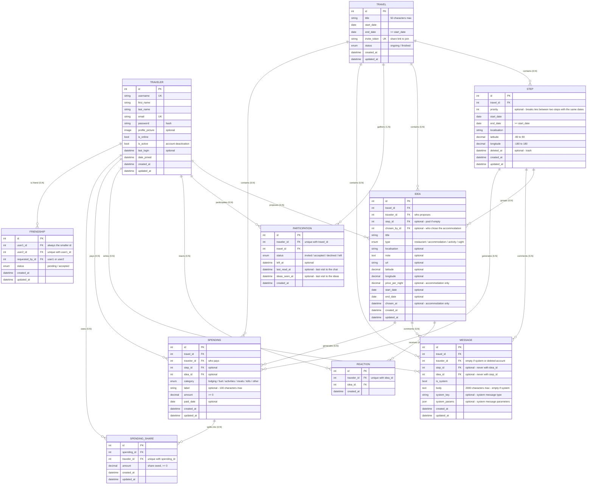

# Data model

**Aligned with the code (`srcs/backend/*/models.py`) as of 11/11/2026.** Field names are those of the Django models.

## Product principles

- **Plan, don't navigate.** On the road, that's Google Maps' job. The app gathers ideas and defines the route together. The order of steps follows from their dates, set by the user, not optimized.
- **The step is the route, the idea is what you do there.** The step draws the line on the map. The idea is a proposal attached to a step or to the trip: where to sleep, eat, what to see.
- **The ❤️ is a signal, not a decision.** You can put as many as you like on ideas, it triggers nothing. Choosing an accommodation is an explicit action.

## Schema

## Notation

- `PK` primary key, `FK` foreign key, `UK` unique value
- `||--o{`: one to many — the cardinality is also written out on each relation
- Every table has an auto `id`. Join tables (`Reaction`, `Participation`, `Friendship`, `SpendingShare`) enforce pair uniqueness with a `UniqueConstraint`, not a composite primary key.
- `created_at` / `updated_at` come from `common.models.TimeStampedModel` (`auto_now_add` / `auto_now`). `Reaction` and `Participation` have no `updated_at`: a ❤️ is never modified, and `left_at` already records a participation's change of state.
- Enumerations are Django `TextChoices` stored as a single character (e.g. `Travel.status`: `c` / `f`).
- `Idea`, `Message`, `Spending` and `SpendingShare` also inherit from `ValidatedModel`: `full_clean()` is called on every `save()`, so the `clean()` rules described below apply everywhere, not only through the API.

## Table details

- **Traveler**: an account, based on Django's `AbstractUser` (hence `username`, `password`, `is_active`, `is_staff`, `last_login`…). `email` is unique. `profile_picture` is a file uploaded to `profile_pictures/`. `is_online` powers friends' online status. Deactivatable (`is_active`) rather than deleted.
- **Travel**: a trip, with its start and end dates (`end_date >= start_date`, database constraint; the API is stricter and requires `end_date > start_date`: a trip lasts at least one night, code `end_not_after_start`). `invite_token` is generated on creation and lets anyone who has it join. No owner: all participants have the same rights. The creator gets an accepted participation.
- **Participation**: who takes part in which trip and where their invitation stands. Someone who left keeps their row (`status` left + `left_at`), so balances stay correct. `last_read_at` and `ideas_seen_at` record the last visit to the chat and to the ideas page: unread items are whatever others created after that, no counter is stored. Accepting an invitation fills both dates, so the history doesn't show up as new.
- **Step**: a stop on the route, defined by `start_date` / `end_date`. The number of nights is not stored: the API computes it (`end_date − start_date`, 0 for a stopover). Unlike the trip, the API accepts `end_date = start_date` for a step (stopover with no night). Two live steps of the same trip cannot overlap (a step may start on the day the previous one ends). `priority` is only used to order two steps with the same dates, and is unique per trip + dates among live steps. Steps are sorted by `start_date`, `end_date`, `priority`, `created_at`. `latitude` / `longitude` are required.
- **Idea**: a proposal made for a trip. Attached to a step, or free in the pool (empty step or step in the trash). Its status is **not stored**, it is derived (see below). Rules checked by `clean()`:
  - the step must belong to the same trip;
  - `start_date` and `end_date` are filled together or not at all, and stay within the step's dates;
  - an accommodation always has dates, at least one night, and if it is in the pool its dates stay within the trip's;
  - any other idea placed on a step has dates, on a single day; in the pool it has none;
  - `price_per_night` is reserved for accommodations;
  - only an accommodation placed on a step can be chosen (`chosen_at`), and two chosen accommodations of the same step cannot overlap.
- **Reaction**: a ❤️ from one person on an idea, only one per person and per idea. Purely indicative.
- **Friendship**: a friendship link between two accounts, independent of trips. `user1 < user2` and `requested_by` ∈ {user1, user2} are database constraints. A refusal or removal deletes the row.
- **Message**: a chat message, attachable to the trip, a step or an idea (not both, database constraint). The author must be a participant (accepted or left) at creation. A system message (`is_system`) has no author, no `body` but a `system_key` (e.g. `participant_joined`, `participant_left`) and `system_params`: the text is built by the front end.
- **Spending**: an expense, attachable to the trip alone (fuel), a step (toll) or an idea (the restaurant we went to). Step and idea must belong to the same trip, and if the idea is on a step, the expense's step must be the same. `amount` is `>= 0` in the database, but the API requires at least `0.01` (no zero-amount expense). `category` drives the groupings on the budget screen, `label` specifies what it is. The payer must be a participant of the trip (status accepted or left).
- **SpendingShare**: the share of an expense owed by a traveler. A traveler has at most one share per expense, and must also be an accepted or left participant. Shares are frozen at creation: someone who leaves the trip still owes the expenses made before they left. Without provided shares, the expense is split equally among accepted participants. The sum of the shares must equal `Spending.amount`, checked by `spending/services.py` (multiple rows, so not in `clean()`).

## Idea status (computed)

`Idea.status` is a property, not a column:

- **proposed** (`s`): in the pool (no step, or step in the trash);
- **chosen** (`c`): accommodation placed on a step with `chosen_at` filled;
- **placed** (`p`): otherwise, idea attached to a live step.

Choosing an accommodation goes through `POST /travels/<id>/ideas/<id>/choice/`, which fills `chosen_at` and `chosen_by`. There is no action yet to undo a choice.

## Deletion behavior

- **Trip**: it isn't deleted, you leave it (like a WhatsApp group). It disappears from your list, nothing changes for the others, and your participation stays in the database (status left) so balances stay correct.
- **Step**: trash (`deleted_at`). Impossible while it has expenses ("move or delete them first"). Its ideas go back to the pool unchanged. No restore endpoint yet (the model has `restore()`). If a step is permanently deleted, its ideas get `step = NULL`, lose their choice and, except for accommodations, their dates.
- **Idea**: permanent deletion. Its reactions go with it (`CASCADE`), its expenses and messages stay on the trip (`SET NULL`).
- **Message**: no deletion through the API. If its author's account is deleted, the message stays in the thread without an author (`SET NULL`).
- **Expense**: permanent deletion, its shares go with it (`CASCADE`). If its step or idea disappears, it just loses its attachment (`SET NULL`).
- **Traveler**: a traveler who paid an expense or owes a share cannot be deleted (`PROTECT`), otherwise others' balances would be silently wrong. Their ideas, reactions, participations and friendships go with them (`CASCADE`). If an idea they chose remains, `chosen_by` becomes empty.

`price_per_night` is descriptive ("this campsite costs 24 CHF/night"), `Spending` is money actually spent. Nothing moves automatically from one to the other.

## Changing the trip's dates

`start_date` and `end_date` remain editable after creation:

- **Extending the period**: immediate update.
- **Shortening the period**: refused if live steps fall outside the new bounds ("move them first"). Nothing is moved to the trash automatically.
- **Creating or editing a step**: through the API, its dates must stay within the trip's. The model can widen the trip to include a step (`Step.extend_travel_dates_to_fit`, called on `save()`), but API validation currently prevents this from happening.

## Change history

| # | Change | Why | Source |
|---|-----------|----------|--------|
| 1 | `Step`: `start_date` / `end_date` + optional `priority` | Replaces the `Position` + `Nights` idea from the meeting minutes: dates are stored, nights computed. `priority` breaks ties between two steps with the same dates. | Minutes 18/07, then code |
| 2 | `Choice` + `Vote` → `Reaction` | v2 required an exclusive vote. The ❤️ is a signal: you can put as many as you like on ideas. | Minutes 18/07 |
| 3 | `chosen_by` / `chosen_at` on `Idea` | Records the act of choosing an accommodation. Status is no longer stored: it is derived from the step and `chosen_at`. | Minutes 18/07, then code |
| 4 | No separate accommodation table | Its only specificity is exclusivity, checked in `Idea.clean()` (no overlap between chosen accommodations of a step). | Minutes 18/07 |
| 5 | Status values defined | See "Statuses" below. | Minutes 18/07 |
| 6 | Status tables → Django enumerations | Short, fixed lists: `TextChoices` protects just as well, without a table or join. https://docs.djangoproject.com/en/5.2/ref/models/fields/#enumeration-types | |
| 7 | `TravelerRole` removed, no owner | Same rights for everyone. You leave a trip, you don't delete it, and the row stays for balances. | Mockup |
| 8 | `Spending`: single `amount` field | No screen compares planned vs. actual. | Mockup |
| 9 | `Spending`: `category` added | The budget screen relies entirely on it. | Mockup |
| 10 | Optional `step` / `idea` on `Spending` and `Message` | An expense belongs to the trip (fuel), a step (toll) or an idea (the restaurant). | Mockup |
| 11 | `Idea`: optional dates depending on type | An accommodation always has dates, other ideas only once placed on a step, on a single day. | Code |
| 12 | `deleted_at` on `Step` only | The trash planned for `Idea` was not implemented: an idea is permanently deleted. | Code |
| 13 | Idea → step promotion | Not implemented. | |
| 14 | `price_per_night` on `Idea` | Shown in the mockup ("95 CHF/night"), reserved for accommodations. | Mockup |
| 15 | `Friendship` table | Required by the "standard user management" module: add friends and see their online status (`Traveler.is_online`). | Subject + mockup |
| 16 | `Travel.invite_token` | Joining a trip goes through a link generated at creation. | Mockup |
| 17 | `Travel.end_date` required, `>= start_date` in the database, `> start_date` in the API | A trip has a known duration from its creation. Shortening the period is refused if steps fall outside it. | Mockup, then code |
| 18 | `Step.latitude` / `longitude` required | The map needs real coordinates. | Mockup |
| 19 | `Idea.latitude` / `longitude` | An idea has its own location, not necessarily its step's. Optional. | Mockup |
| 20 | `Spending.label` | `category` says the type of expense, not which one. | |
| 21 | Expense payer = trip participant | An expense paid by an outsider would skew balances. "Left" is still accepted. | |
| 22 | `SpendingShare` table | Split an expense among the participants present when it is made. Exact amount per share rather than a weight. | |
| 23 | `Message`: neither `Enabled` nor `deleted_at` | Messages cannot be deleted through the API. | Code |
| 24 | `Participation.last_read_at` | Chat unread count, computed from the date. | Code |
| 25 | `Message`: a step or an idea, not both | Database constraint. | Code |
| 26 | `Participation.ideas_seen_at` | Same principle as `last_read_at`, for the new-ideas badge. | Code |
| 27 | `Message.system_key` / `system_params` | System messages (participant joining, leaving) are translated on the front end rather than stored as text. | Code |
| 28 | `Idea.note` / `Idea.url` | Free comment and link (website, booking) on an idea. | Code |
| 29 | `Traveler` based on `AbstractUser` | Reuses Django authentication: `first_name`, `password`, `is_active`… come from there. `profile_picture` is a file, not a URL. | Code |
| 30 | Step with expenses cannot be deleted | Avoids losing expenses' attachment by accident. | Code |

### Statuses (item 5)

- **`Travel`**: ongoing (`c`) → finished (`f`). No "cancelled" status: a trip that will never happen, you leave it.
- **`Idea`**: proposed → placed → chosen, computed (see above). An unplaced idea stays in the pool indefinitely: it never disappears for lack of ❤️.
- **`Participation`**: invited → accepted / declined, then accepted → left.
- **`Friendship`**: pending → accepted. A refusal deletes the row.
